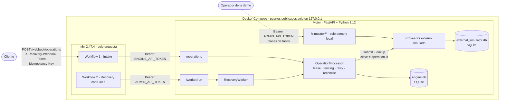
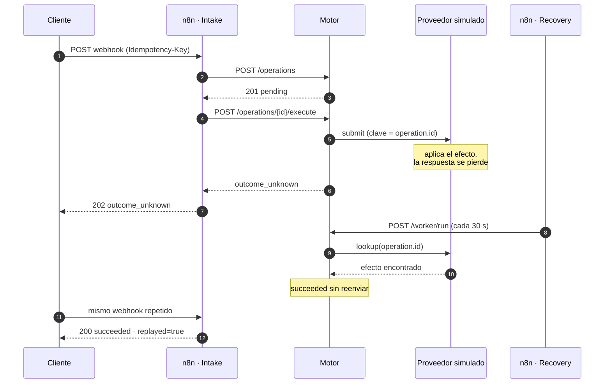
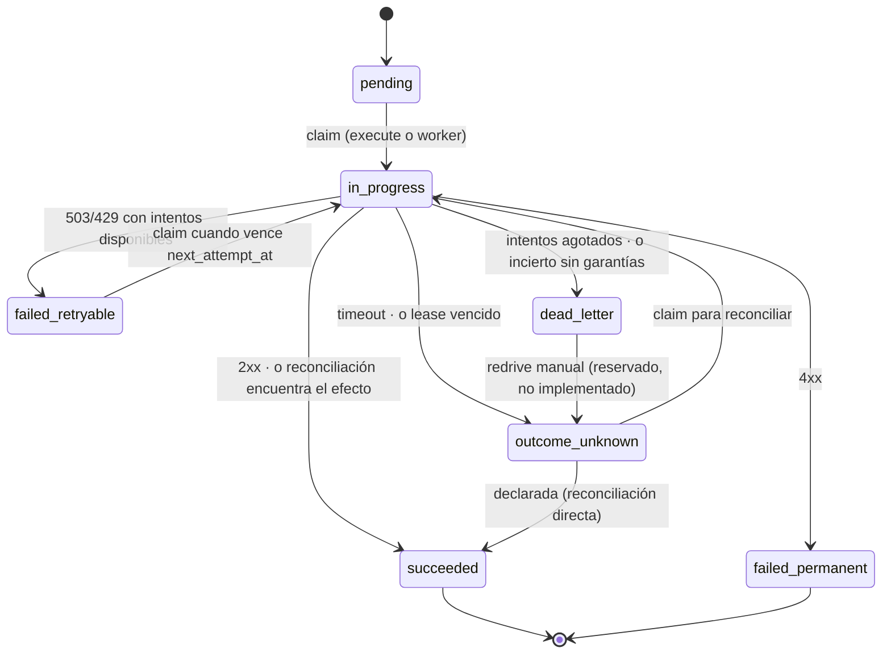

# AI Workflow Recovery Engine

[](https://github.com/cucuarce/ai-workflow-recovery-engine/actions/workflows/tests.yml)


Motor que recibe operaciones por API, las ejecuta contra un servicio externo (simulado) que
puede fallar de distintas formas, persiste cada estado e intento en SQLite y **recupera las
operaciones sin duplicar efectos de negocio**. n8n orquesta la entrada (webhook) y dispara la
recuperación periódica. Toda la lógica de recuperación vive en Python.

> **Sin LLMs.** Pese al nombre del proyecto, el motor es **determinístico**: no ejecuta modelos
> de lenguaje ni toma decisiones probabilísticas. Cada transición sale de reglas explícitas
> (códigos de respuesta, política de reintentos, lease y resultado de la reconciliación), y los
> tests usan un reloj controlado y jitter desactivado o sembrado para reproducir cada caso.

> **Estado del proyecto.** Es un proyecto de portfolio y demostración, **no está listo para
> producción**. Corre en local (`127.0.0.1`) con Docker Compose, usa SQLite y un proveedor
> externo **simulado**, y autentica con secretos compartidos sin TLS. Ver
> [Limitaciones conocidas](#limitaciones-conocidas).
>
> Sobre las badges: `tests` muestra el estado real de GitHub Actions una vez que el repositorio
> esté publicado y el workflow haya corrido. La badge de 265 tests es **estática**: refleja la
> última verificación local, no una ejecución de CI.

## Contenido

- [Problema que resuelve](#problema-que-resuelve)
- [Arquitectura](#arquitectura)
- [Mecanismos de recuperación](#mecanismos-de-recuperación)
- [Requisitos previos](#requisitos-previos)
- [Instalación y tests](#instalación-y-tests)
- [Demo: timeout después del efecto](#demo-timeout-después-del-efecto)
- [Resultados verificados](#resultados-verificados)
- [Integración continua](#integración-continua)
- [Referencia](#referencia): estados, endpoints, simulador, configuración y escenarios manuales
- [Decisiones de diseño](#decisiones-de-diseño)
- [Limitaciones conocidas](#limitaciones-conocidas)

Runbook completo de la integración con n8n (credenciales, workflows, verificaciones y riesgos):
[`docs/etapa3-n8n.md`](docs/etapa3-n8n.md).

---

## Problema que resuelve

Cuando un sistema llama a una API externa, tiene que manejar tres situaciones distintas:

| Lo que ve el cliente | Lo que pudo pasar realmente |
|---|---|
| `2xx` | El efecto se aplicó. |
| `429` / `503` / `4xx` | El receptor rechazó el pedido sin procesarlo. |
| **Timeout** o **caída del proceso** | **Cualquiera de las dos cosas.** |

Reintentar a ciegas puede duplicar el efecto (doble factura, doble cobro). No reintentar nunca
deja operaciones colgadas. Este motor distingue los casos y solo reenvía cuando es seguro:
ante un timeout **primero consulta** al proveedor si el efecto existe (reconciliación) y solo
reenvía, con la misma clave idempotente, si el receptor garantiza deduplicación.

---

## Arquitectura



- **n8n no accede a las bases.** Solo llama al motor por HTTP dentro de la red de compose, con
  dos credenciales separadas: el Workflow 1 usa el token de API y nunca el administrativo.
- **Dos bases separadas.** El efecto externo y el estado local nunca se confirman en la misma
  transacción. Las transacciones locales son cortas y **ninguna abarca una llamada externa**.
- **Un solo camino de procesamiento** (`OperationProcessor`). Lo usan tanto `execute` (primer
  intento) como el worker (reintentos y recuperación).
- **El motor depende de un contrato** (`ExternalServiceClient`). Las capacidades `lookup` y
  `supports_idempotency` son opcionales; sin ellas, el motor se vuelve más conservador.
- **El proveedor es un simulador** con su propia base: aplica efectos, registra cada pedido y
  permite inyectar fallos (`503`, `429`, timeouts antes y después del efecto, `4xx`).

### Estructura del proyecto

```
src/recovery_engine/
├── config.py · clock.py · runtime.py   # settings validados (APP_ENV), reloj/IDs, cableado
├── cli.py                              # recovery-engine worker | fault-plan | show
├── domain/
│   ├── models.py          # Operation, Attempt, estados, outcomes
│   ├── state_machine.py   # transiciones permitidas
│   ├── retry.py           # RetryPolicy, backoff, jitter, Retry-After
│   ├── outcomes.py · hashing.py · errors.py
├── persistence/
│   ├── db.py              # conexiones, BEGIN IMMEDIATE, hook de migración
│   ├── schema.py          # esquema v2 + migración desde la versión 1
│   └── repositories.py    # compare-and-set con fencing
├── external/
│   ├── contracts.py       # contrato + ExternalLookup
│   └── simulator.py       # fallos, idempotencia receptora, fault plans, lookup
├── services/
│   ├── operations.py      # create / get / list / execute
│   ├── processing.py      # claim, reconciliación, envío, registro
│   └── worker.py          # RecoveryWorker.run_once
└── api/
    ├── security.py        # Bearer: ENGINE_API_TOKEN / ADMIN_API_TOKEN
    ├── operations_routes.py · simulator_routes.py
    ├── admin_routes.py    # POST /worker/run (admin)
    └── fault_plan_routes.py  # PUT fault-plans (admin + inyección; solo demo/local)
tests/
├── support.py             # FakeClock, clientes que simulan caídas, configuración de tests
├── unit/                  # política de reintentos, estados, simulador, workflows n8n
└── integration/           # recuperación, migración, worker, API, seguridad, flujos n8n
n8n/workflows/             # 01-intake.json, 02-recovery.json (importables, sin secretos)
Dockerfile · compose.yaml · .env.example   # entorno local motor + n8n
scripts/smoke_compose.py   # smoke de Docker Compose + demo
docs/etapa3-n8n.md         # runbook de la integración
.github/workflows/tests.yml  # CI: lockfile, pytest y Ruff
```

---

## Mecanismos de recuperación

### Idempotencia: qué garantiza y qué no

| Capa | Mecanismo | Garantía |
|---|---|---|
| Entrada (motor) | `UNIQUE(idempotency_key)` + hash canónico + `BEGIN IMMEDIATE` | Un webhook duplicado (aun durante un reintento) devuelve la misma operación. La misma clave con otro payload da `409`. |
| n8n | La clave sale del header `Idempotency-Key` del cliente; n8n **nunca** la genera | Un reintento del cliente no crea otra operación. |
| Hacia el proveedor | `idempotency_key = operation.id` en **todos** los envíos | El motor nunca genera una clave nueva para la misma operación lógica. |
| Proveedor | Registro de idempotencia del receptor | Un reenvío con la misma clave devuelve el efecto original. |

> **Límite importante:** la garantía de "un solo efecto" ante resultados inciertos **depende del
> receptor externo**. El motor solo reenvía tras una incertidumbre si el proveedor declara
> `supports_idempotency`. Si no lo hace, solo resuelve cuando `lookup` encuentra el efecto. Un
> "no encontrado" sin idempotencia del receptor **no** se considera suficiente, porque un pedido
> demorado todavía podría procesarse, y la operación va a `dead_letter` para revisión humana.
> Si un proveedor real declara idempotencia pero no la cumple (claves que expiran, deduplicación
> por ventana de tiempo, etc.), la garantía se pierde. Eso queda fuera del control del motor.
> No es *exactly-once* de extremo a extremo.

### Reintentos y backoff (`domain/retry.py`)

- **Solo se reintentan** `503` (`retryable_error`) y `429` (`rate_limited`). Un `4xx` va a
  `failed_permanent` y nunca se reintenta. Un timeout no se "reintenta": se reconcilia.
- **Delay tras el intento n:** `min(max_delay, base · 2^(n-1))`, con jitter aplicado y el mismo tope.
- **Jitter inyectable.** Por defecto es *equal jitter* (`d/2 + U(0, d/2)`). En tests se usa
  `no_jitter` o un `random.Random` sembrado.
- **`Retry-After` en 429.** Se aceptan *delay-seconds* (entero ≥ 0) y *HTTP-date*:
  - una fecha pasada vale 0;
  - un valor vacío, negativo, decimal, con dígitos no ASCII o mal formado se considera inválido, y se usa el backoff;
  - el delay final es `max(backoff, Retry-After)`, así que nunca se reintenta antes de lo pedido;
  - el valor se acota a `max_retry_after_seconds` para que un valor absurdo no bloquee la operación indefinidamente;
  - el jitter no se aplica sobre `Retry-After`.
- **`max_attempts`** cuenta solo envíos (`submit`). Las consultas de reconciliación no consumen
  intentos. Al agotarse, la operación va a `dead_letter`.
- **Todo queda registrado en el intento:** `retry_after` (header crudo), `retry_decision` (por
  ejemplo `retry in 4.000s (exponential_backoff)` o `no_retry: max_attempts_exhausted (4)`) y
  `next_retry_at`. La transición guarda el mismo motivo.

### Lease y ownership

- **Reclamar** es un `UPDATE ... WHERE id = ? AND status = ? AND lease_token = ?` dentro de
  `BEGIN IMMEDIATE`. Fija `lease_owner`, `lease_expires_at = now + LEASE_TTL_SECONDS` y
  `lease_token = lease_token + 1`. Dos workers nunca obtienen el mismo lease.
- Una operación `in_progress` es reclamable **solo si su lease venció**. Al reclamarla:
  - los intentos abiertos se cierran como `abandoned`;
  - la operación pasa por `in_progress → outcome_unknown → in_progress`, con un token nuevo;
  - y se reconcilia antes de cualquier reenvío.
- Una operación `pending` (registrada pero sin primer intento, por ejemplo porque n8n se cayó
  entre el registro y el `execute`) también es reclamable: el worker la completa.
- Las filas `in_progress` heredadas de la versión 1 del esquema (sin lease) se tratan como vencidas.

### Fencing

Cada escritura posterior al claim (reservar el envío, registrar el resultado, cerrar la
operación) exige `status = 'in_progress' AND lease_token = <token del claim>`. Si otro worker
re-reclamó la operación, el token ya no coincide y pasa lo siguiente:
- la transacción del worker viejo falla con `LeaseLostError` y se revierte completa;
- su intento ya fue cerrado como `abandoned` por el nuevo dueño;
- si el lease ya estaba perdido antes del envío, el worker viejo **ni siquiera llama al proveedor**.

Un worker cuyo lease venció pero que nadie re-reclamó **sí puede** registrar su resultado: el
token sigue siendo suyo y el dato es válido.

### Reconciliación de resultados inciertos

Cuando el worker reclama una operación en `outcome_unknown`, o un `in_progress` con lease vencido:

1. **`lookup(operation.id)`** consulta el estado persistido del proveedor (fuera de transacción).
   El resultado se guarda como intento de tipo `reconcile`.
2. **Efecto encontrado:** `succeeded` con ese `external_effect_id`. **No se reenvía.**
3. **No encontrado** (o el proveedor no ofrece lookup):
   - si quedan intentos **y** el receptor declara `supports_idempotency`: se reenvía con **la misma
     clave**, y si el efecto ya existía, el receptor deduplica;
   - en cualquier otro caso: `dead_letter`, con el motivo (`max_attempts_exhausted` o
     `uncertain_outcome_requires_manual_reconciliation`).

### Worker

`RecoveryWorker.run_once(max_operations)`:
- reclama operaciones vencidas una a una, en orden determinístico (`created_at, id`);
- procesa cada una **como máximo una vez por corrida**, hasta `max_operations`;
- no duerme ni agenda nada: quien lo dispara decide la frecuencia. Correrlo de nuevo sin
  operaciones vencidas no produce ningún efecto;
- es seguro ejecutarlo de forma repetida y concurrente;
- un error inesperado del proveedor no detiene la corrida: la operación queda con lease y se
  recupera cuando vence.

Se dispara por **CLI** (`uv run recovery-engine worker --max-operations 10`) o por **HTTP**
(`POST /worker/run`, opt-in y con `ADMIN_API_TOKEN`), que es lo que hace el Workflow 2 de n8n
cada 30 s.

---

## Requisitos previos

| Para | Necesitás |
|---|---|
| Tests y ejecución local | [Python 3.12](https://www.python.org/downloads/) y [uv](https://docs.astral.sh/uv/) (verificado con uv 0.12.23). Git para clonar. |
| Demo con n8n | Además, Docker Desktop o Docker Engine con Compose v2, y los puertos `8000` y `5678` libres en `127.0.0.1`. |

No hace falta ninguna cuenta ni servicio externo: el proveedor es un simulador local, y n8n
corre con diagnósticos, plantillas y avisos de versión apagados.

## Instalación y tests

```bash
git clone https://github.com/cucuarce/ai-workflow-recovery-engine.git
cd ai-workflow-recovery-engine
uv sync --locked                     # dependencias exactas de uv.lock (incluye las de desarrollo)
uv run --locked python -m pytest     # 265 tests; no requieren Docker, red ni secretos
uv run --locked ruff check .
uv run --locked ruff format --check .
```

### Ejecutar la API en local

La configuración es **segura por defecto** (`APP_ENV=production`): sin `ENGINE_API_TOKEN` la
aplicación no arranca, la inyección de fallos está prohibida y las rutas `/simulator/*` no
existen. Para desarrollo local, declarar el entorno explícitamente:

```bash
export APP_ENV=local FAULT_INJECTION_ENABLED=true   # solo en tu máquina; escucha en 127.0.0.1
uv run uvicorn recovery_engine.api.app:create_app --factory --reload   # http://127.0.0.1:8000/docs
```

En PowerShell: `$env:APP_ENV="local"; $env:FAULT_INJECTION_ENABLED="true"`.
Los escenarios reproducibles por CLI están en [Escenarios manuales](#escenarios-manuales).

---

## Demo: timeout después del efecto

Es el caso más delicado: el proveedor **aplica el efecto** pero la respuesta no llega. El motor
no sabe si ocurrió; reintentar a ciegas lo duplicaría.



### Opción rápida: smoke automatizado

```bash
cp .env.example .env
# Reemplazar CADA "replace-me" por un valor aleatorio distinto de al menos 32 caracteres:
python -c "import secrets; print(secrets.token_urlsafe(32))"
uv run python scripts/smoke_compose.py          # agregar --down para bajar el stack al terminar
```

El script levanta el stack (`docker compose up --build --wait`), crea las credenciales de n8n
desde `.env` sin escribirlas en el host, importa y publica los workflows, ejecuta la demo y
verifica exposición, autenticación, aislamiento y ausencia de secretos. Nunca imprime secretos.

### Paso a paso manual

Con el stack levantado y los workflows importados (ver la sección 5 del
[runbook](docs/etapa3-n8n.md)), y las variables de `.env` cargadas en la shell
(`set -a; . ./.env; set +a`):

1. **El operador configura el fallo** antes del pedido, con el token administrativo:
   ```bash
   KEY=demo-$(date +%s)
   curl -s -X PUT "http://127.0.0.1:8000/simulator/fault-plans/by-idempotency-key/$KEY" \
     -H "Authorization: Bearer $ADMIN_API_TOKEN" -H 'Content-Type: application/json' \
     -d '{"faults":[{"scenario":"timeout_after_processing"}]}'
   ```
2. **El cliente envía un pedido normal** al webhook. No puede elegir el fallo: un campo
   `scenario` se rechaza con `400 unexpected_fields`.
   ```bash
   curl -s -i -X POST http://127.0.0.1:5678/webhook/operations \
     -H "X-Recovery-Webhook-Token: $WEBHOOK_SECRET" -H "Idempotency-Key: $KEY" \
     -H 'Content-Type: application/json' \
     -d '{"operation_type":"issue_invoice","payload":{"customer_id":"c-001","amount_cents":15000}}'
   ```
   Respuesta: **`202`** con `"status": "outcome_unknown"`. Anotar `OP=<operation_id>`.
3. **El proveedor aplicó el efecto** aunque el motor no recibió la respuesta:
   ```bash
   curl -s "http://127.0.0.1:8000/simulator/requests?operation_ref=$OP" \
     -H "Authorization: Bearer $ADMIN_API_TOKEN"     # effect_applied=true, delivered_to_client=false
   ```
4. **Reconciliación.** En 30 s como máximo, el Workflow 2 dispara el worker:
   ```bash
   curl -s "http://127.0.0.1:8000/operations/$OP" -H "Authorization: Bearer $ENGINE_API_TOKEN"
   # status=succeeded; attempts: submit/timeout (api) y reconcile/effect_found (n8n-recovery)
   ```
5. **Evidencia** (token admin): `/simulator/requests?operation_ref=$OP` (1 solicitud),
   `/simulator/effects?operation_ref=$OP` (1 efecto), `/simulator/lookups?idempotency_key=$OP`
   (1 consulta con `found=true`) y `/simulator/duplicates` (`[]`).
6. **Webhook repetido** con la misma clave: **`200`**, la misma operación, `"replayed": true`.

La nota para PowerShell y el detalle de cada nodo están en el [runbook](docs/etapa3-n8n.md).
Para detener el stack: `docker compose down` (con `-v` también borra los volúmenes de datos).

---

## Resultados verificados

Última verificación local: **12 de noviembre de 2026**, sobre el commit de cierre de la integración
con n8n.

**Demo `timeout_after_processing`** (Docker Compose con n8n real):

| Verificación | Resultado |
|---|---|
| Solicitudes originales al proveedor | **1** |
| Efectos aplicados | **1** |
| Reconciliaciones (lookup que encontró el efecto) | **1** |
| Reenvíos | **0** |
| Duplicados en el proveedor | **0** |
| Estado final | `succeeded`, enlazado al `effect_id` del proveedor |
| Webhook repetido | `200`, `replayed: true`, sin nuevas solicitudes |

**Suite y smoke:**

| Verificación | Resultado |
|---|---|
| `pytest` | **265 aprobados** (Windows; también en un clon limpio sobre Linux, sin red) |
| `ruff check` y `ruff format --check` | sin observaciones |
| Smoke de Docker Compose | **41/41** verificaciones: puertos solo en `127.0.0.1`, n8n sin acceso a las bases, matriz de tokens, demo, operación `pending` recuperada, `dead_letter` → `409`, y sin secretos en logs, exportaciones de n8n, su base ni el repo |

Estos resultados son de ejecuciones locales; no los produjo CI.

## Integración continua

[`.github/workflows/tests.yml`](.github/workflows/tests.yml) corre en `push` y `pull_request` a
`main`, y a demanda (`workflow_dispatch`):

1. `uv lock --check`: el lockfile coincide con `pyproject.toml`;
2. `uv sync --locked`: instala exactamente las versiones de `uv.lock`, con Python 3.12;
3. `uv run --locked python -m pytest`;
4. `ruff check` y `ruff format --check`.

Usa permisos de solo lectura y ningún secreto. No levanta Docker ni n8n: los tests no los
necesitan. El smoke de Docker Compose se ejecuta solo en local.

---

## Referencia

### Estados



| Estado | Significado | ¿El worker lo toma? | Respuesta del webhook |
|---|---|---|---|
| `pending` | Registrada, sin intentos. | Sí, de inmediato. | `202` |
| `in_progress` | Reclamada con lease. Puede tener un envío en vuelo. | Solo si el lease **venció**. | `202` |
| `succeeded` | Efecto confirmado. Terminal. | No. | `200` |
| `failed_retryable` | Rechazo sin procesar, con reintento programado. | Cuando vence `next_attempt_at`. | `202` |
| `outcome_unknown` | No se sabe si el efecto ocurrió. | Cuando vence `next_attempt_at`, para **reconciliar**. | `202` |
| `failed_permanent` | Rechazo definitivo. Terminal. | No. | `422` |
| `dead_letter` | Recuperación automática agotada o insegura. Requiere intervención. | No. | `409` con `reason` |

**Invariantes:**
- `outcome_unknown` nunca pasa directo a un estado de fallo.
- `dead_letter` solo puede salir hacia `outcome_unknown`, es decir, volviendo a pasar por reconciliación.

### Endpoints

| Método | Ruta | Token | Descripción |
|---|---|---|---|
| `POST` | `/operations` | API | Registra una operación (header `Idempotency-Key` obligatorio). `201` nueva / `200` reutilizada / `409` conflicto. Campos extra: `422`. |
| `GET` | `/operations` | API | Lista, con filtro `?status=` (incluye `dead_letter`). |
| `GET` | `/operations/{id}` | API | Detalle: estado, lease, `next_attempt_at`, intentos (tipo, decisión, token, worker) y transiciones (token, actor). |
| `POST` | `/operations/{id}/execute` | API | **Primer** intento de una operación `pending`. `{"scenario": "..."}` solo se acepta con `APP_ENV=local`; en otro entorno, `403`. Sobre otro estado devuelve `409`. |
| `GET` | `/simulator/requests` · `/effects` · `/duplicates` · `/lookups` | admin | Observación del proveedor simulado. Solo en `demo`/`local`, con inyección de fallos o endpoints admin habilitados. **Nunca en `production`**. |
| `POST` | `/worker/run` | admin | Una corrida del worker. Requiere `ENABLE_ADMIN_ENDPOINTS=true`. |
| `PUT` | `/simulator/fault-plans/{operation_id}` | admin | Guion de fallos de una operación. Requiere endpoints admin **e** inyección de fallos (nunca en `production`). |
| `PUT` | `/simulator/fault-plans/by-idempotency-key/{key}` | admin | Ídem, cargado **antes** del pedido, por la clave del cliente. Es la vía de la demo con n8n. |
| `GET` | `/health` | — | Estado del servicio. |

> **Autenticación.** `Authorization: Bearer <token>`. Sin token: `401`; con un token inválido o
> de la otra superficie: `403`. `ENGINE_API_TOKEN` y `ADMIN_API_TOKEN` deben ser distintos y
> tener al menos 32 caracteres. Solo con `APP_ENV=local` se puede omitir el token de API
> (desarrollo en `127.0.0.1` y tests). Los endpoints administrativos exigen `ADMIN_API_TOKEN`
> en **todos** los entornos. Los errores `401`/`403` usan el formato estándar de FastAPI
> (`{"detail": {"error", "detail"}}`), distinto del formato plano del resto; se conserva así.

### Simulador de fallos

El escenario de cada envío sale, en este orden de prioridad, de:
1. el escenario forzado en `execute` (solo `APP_ENV=local`);
2. la próxima entrada del **fault plan** de la operación;
3. si la operación no tiene plan propio, la próxima entrada del plan cargado por la
   `Idempotency-Key` del cliente;
4. `success`, si no hay ninguno de los anteriores.

| Escenario | ¿Procesa? | ¿Llega la respuesta? | Resultado en el motor |
|---|---|---|---|
| `success` | Sí | Sí (`201`, o `200` deduplicado) | `succeeded` |
| `http_503` | No | Sí | reintento con backoff |
| `http_429` | No | Sí (`Retry-After`: 30 por defecto o el valor del plan) | reintento respetando `Retry-After` |
| `timeout_before_processing` | No | No | `outcome_unknown` → reconciliar → reenviar |
| `timeout_after_processing` | **Sí** | No | `outcome_unknown` → reconciliar → `succeeded` sin reenvío |
| `permanent_error` | No | Sí (`422`) | `failed_permanent` |

Con `SIMULATOR_HONOR_IDEMPOTENCY=false`, el receptor no deduplica y declara
`supports_idempotency = false`.

### Configuración

| Variable | Default | Uso |
|---|---|---|
| `APP_ENV` | `production` | `production` / `demo` / `local`. Ver la matriz en el [runbook](docs/etapa3-n8n.md). |
| `ENGINE_API_TOKEN` | — | Bearer de `/operations*`. Obligatorio fuera de `local`. |
| `ADMIN_API_TOKEN` | — | Bearer del worker, planes de fallos y `/simulator/*`. |
| `FAULT_INJECTION_ENABLED` | `false` | Simulación de fallos a pedido. Prohibida en `production`. |
| `ENABLE_ADMIN_ENDPOINTS` | `false` | Monta `/worker/run` (y los planes de fallos si hay inyección). Exige `ADMIN_API_TOKEN`. |
| `RECOVERY_DATA_DIR` | `data` | Carpeta de las dos bases. |
| `RECOVERY_ENGINE_DB` / `RECOVERY_SIMULATOR_DB` | `<data>/engine.db` / `<data>/external_simulator.db` | Rutas explícitas. |
| `RETRY_MAX_ATTEMPTS` | `5` | Envíos máximos por operación. |
| `RETRY_BASE_DELAY_SECONDS` / `RETRY_MAX_DELAY_SECONDS` | `1` / `300` | Backoff exponencial. |
| `RETRY_AFTER_MAX_SECONDS` | `3600` | Tope para `Retry-After`. |
| `RETRY_JITTER` | `true` | `false` hace los delays exactos (útil para demos). |
| `LEASE_TTL_SECONDS` | `30` | Duración del lease. Debe superar el timeout del proveedor. |
| `SIMULATOR_HONOR_IDEMPOTENCY` | `true` | Idempotencia del receptor. |

Las bases de la versión 1 del esquema se migran automáticamente al iniciar la API o el CLI
(esquema v2, `PRAGMA user_version = 2`). La migración reconstruye `operations` y `attempts`
(porque cambian sus `CHECK`), agrega columnas a `operation_transitions`, conserva todos los
datos y verifica las claves foráneas. Es idempotente. Se recomienda **hacer un backup** del
archivo antes de migrar una base con datos que importen.

### Escenarios manuales

Los ejemplos usan el **CLI**, que no requiere habilitar endpoints administrativos, en modo
`local`. API y CLI comparten las bases a través de `RECOVERY_DATA_DIR`. Si querés reiniciar el
entorno, borrá la carpeta `data/`.

```bash
export APP_ENV=local FAULT_INJECTION_ENABLED=true RETRY_JITTER=false RETRY_BASE_DELAY_SECONDS=1
uv run uvicorn recovery_engine.api.app:create_app --factory &   # o en otra terminal

# Registrar una operación (anotar el "id")
curl -s -X POST localhost:8000/operations -H 'Content-Type: application/json' \
  -H 'Idempotency-Key: demo-001' \
  -d '{"operation_type":"issue_invoice","payload":{"customer_id":"c-001","amount_cents":15000}}'
OP=<id>
```

**1. 503 y recuperación**
```bash
uv run recovery-engine fault-plan $OP http_503
uv run recovery-engine worker          # -> failed_retryable, next_attempt_at = now + 1s
sleep 1; uv run recovery-engine worker # -> succeeded
uv run recovery-engine show $OP        # intentos, decisiones de retry y efecto único
```

**2. 429 con Retry-After**
```bash
uv run recovery-engine fault-plan $OP http_429@5          # o una HTTP-date: "http_429@Wed, 21 Oct 2026 07:28:00 GMT"
uv run recovery-engine worker                             # retry_decision: "retry in 5.000s (retry_after)"
uv run recovery-engine worker                             # processed: 0 (no venció)
sleep 5; uv run recovery-engine worker                    # -> succeeded
```

**3/4. Timeout antes o después del efecto**
```bash
uv run recovery-engine fault-plan $OP timeout_after_processing   # o timeout_before_processing
uv run recovery-engine worker                                    # -> outcome_unknown
sleep 1; uv run recovery-engine worker   # after: "reconciled" sin reenvío; before: reenvío con la misma clave
curl -s "localhost:8000/simulator/effects?operation_ref=$OP"     # siempre un solo efecto
curl -s localhost:8000/simulator/duplicates                      # []
```

**5. Webhook duplicado durante un reintento.** Con la operación en `failed_retryable`, repetí
el `POST /operations` con la misma `Idempotency-Key`: devuelve `200`, la misma operación y su
estado actual, sin crear nada nuevo.

**6. Error permanente y dead-letter**
```bash
uv run recovery-engine fault-plan $OP permanent_error && uv run recovery-engine worker   # failed_permanent
# Con otra operación nueva (OP2), agotar los intentos:
RETRY_MAX_ATTEMPTS=2 uv run recovery-engine fault-plan $OP2 http_503 http_503
RETRY_MAX_ATTEMPTS=2 uv run recovery-engine worker; sleep 1
RETRY_MAX_ATTEMPTS=2 uv run recovery-engine worker            # -> dead_letter
curl -s "localhost:8000/operations?status=dead_letter"
```

**7. Recuperación manual tras una caída.** Si un proceso murió con operaciones en `in_progress`,
no hace falta hacer nada especial. Cuando vence el lease (`LEASE_TTL_SECONDS`), una corrida del
worker las toma, cierra el intento colgado como `abandoned`, consulta al proveedor y solo
reenvía si es seguro:
```bash
curl -s "localhost:8000/operations?status=in_progress"   # ver lease_owner / lease_expires_at
uv run recovery-engine worker --worker-id manual-recovery
uv run recovery-engine show <id>                          # intentos: abandoned -> reconcile -> ...
```

Equivalente por HTTP, con `ENABLE_ADMIN_ENDPOINTS=true` y `ADMIN_API_TOKEN` definido:
`curl -s -X POST "localhost:8000/worker/run?max_operations=10" -H "Authorization: Bearer $ADMIN_API_TOKEN"`.

---

## Decisiones de diseño

- **Un timeout se reconcilia, no se reintenta.** El reenvío solo ocurre después de consultar
  al proveedor, y únicamente si el receptor garantiza idempotencia.
- **Fencing por token monotónico, no por reloj.** La expiración del lease solo decide *cuándo*
  otro puede reclamar. *Quién* puede escribir lo decide el token. Así, la deriva del reloj no
  rompe la exclusión.
- **`execute` se mantiene como "primer intento".** Los reintentos manuales irían en contra del
  backoff, así que los hace solo el worker.
- **Worker acotado y sin scheduler.** Es determinístico y fácil de disparar desde cron, CLI o n8n.
- **n8n solo orquesta.** Dos workflows sin nodos de código: intake (validar, registrar, primer
  intento, responder) y recovery (disparar el worker). La recuperación sigue en Python.
- **Configuración segura por defecto.** `Settings()` es `production`; las combinaciones
  inseguras no se pueden construir, así que la aplicación no arranca. Los tests declaran
  explícitamente su entorno (`LOCAL_TEST_CONFIG` en `tests/support.py`).
- **Credenciales separadas.** `ENGINE_API_TOKEN` (registro y consulta) y `ADMIN_API_TOKEN`
  (worker y simulador) no son intercambiables; quien llama al webhook no puede elegir fallos.
- **Endpoints administrativos apagados por defecto** y, cuando se habilitan, siempre con
  `ADMIN_API_TOKEN`. El CLI cubre la operación local.
- **`dead_letter` no es terminal en el modelo.** Queda declarada una salida de redrive manual
  que siempre pasa por reconciliación, pero todavía no tiene comando ni endpoint.

## Limitaciones conocidas

Este proyecto **no está listo para producción**. Las limitaciones reales son:

- **La garantía de un solo efecto depende del receptor.** Requiere que el proveedor responda
  con fidelidad a `lookup` y respete la clave de idempotencia. No es *exactly-once* frente a un
  receptor que no lo haga (ver [Idempotencia](#idempotencia-qué-garantiza-y-qué-no)).
- **Sin renovación del lease (heartbeat).** `LEASE_TTL_SECONDS` debe superar holgadamente el
  timeout del proveedor. Si una llamada dura más que el lease, otro worker puede reclamar y
  reconciliar en paralelo. El fencing evita la escritura obsoleta, pero el proveedor puede
  recibir dos pedidos con la misma clave, y ahí la deduplicación queda en manos del receptor.
- **SQLite.** Serializa las escrituras y la demo corre un único proceso. Alcanza para el MVP;
  con muchos workers en paralelo convendría PostgreSQL con `SELECT ... FOR UPDATE SKIP LOCKED`.
- **Secretos compartidos.** Bearer en el motor y Header Auth en el webhook, sin usuarios,
  rotación automática ni revocación individual.
- **Sin TLS.** Todo corre sobre HTTP en `127.0.0.1` y la red interna de compose. Para uso
  externo se requieren TLS y controles adicionales (proxy, límite de tasa, rotación de secretos).
- **Sin redrive manual de `dead_letter`.** La transición está declarada, pero no hay comando ni
  endpoint: hoy una operación en `dead_letter` requiere intervención directa.
- **Proveedor simulado.** No hay integración con un proveedor real; las garantías se
  demostraron contra el simulador.
- **Secreto del webhook en n8n:** n8n guarda los headers entrantes en los datos de ejecución.
  El intake no guarda ejecuciones y compose fuerza su borrado físico en alrededor de 1 minuto;
  hasta un `VACUUM` pueden quedar bytes en páginas libres de su base local (ver el runbook).
- **Un resultado tardío descartado por fencing** no se guarda localmente. La verdad queda en el
  log del proveedor y el nuevo dueño la recupera por reconciliación.
- **El hash del payload depende del JSON** (`1` ≠ `1.0`), y las claves idempotentes no expiran.

## Licencia

[MIT](LICENSE) © 2026 Alberto Arce.
