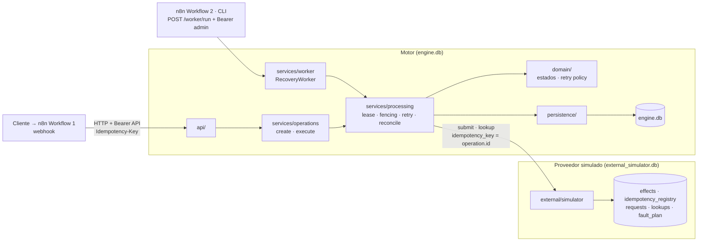

# AI Workflow Recovery Engine

Motor que recibe operaciones por API, las ejecuta contra un servicio externo (simulado) que
puede fallar de distintas formas, persiste cada estado e intento en SQLite y **recupera las
operaciones sin duplicar efectos de negocio**.

> **Estado: Etapa 3 implementada (pendiente de revisión).** Incluye:
> - registro idempotente;
> - simulación de fallos;
> - reintentos con backoff exponencial, jitter y respeto de `Retry-After`;
> - lease con fencing;
> - recuperación tras caídas;
> - reconciliación de resultados inciertos y dead-letter;
> - **integración con n8n** (Docker Compose, webhook de entrada y worker periódico),
>   autenticación con tokens separados y configuración segura por defecto.
>
> Runbook de la integración, demo y riesgos: [`docs/etapa3-n8n.md`](docs/etapa3-n8n.md).

---

## Problema que resuelve

Cuando un sistema llama a una API externa, tiene que manejar tres situaciones distintas:

| Lo que ve el cliente | Lo que pudo pasar realmente |
|---|---|
| `2xx` | El efecto se aplicó. |
| `429` / `503` / `4xx` | El receptor rechazó el pedido sin procesarlo. |
| **Timeout** o **caída del proceso** | **Cualquiera de las dos cosas.** |

Reintentar a ciegas puede duplicar el efecto (doble factura, doble cobro). No reintentar nunca
deja operaciones colgadas. Este motor distingue los casos y solo reenvía cuando es seguro.

---

## Arquitectura



- **Dos bases separadas.** El efecto externo y el estado local nunca se confirman en la misma
  transacción. Las transacciones locales son cortas y **ninguna abarca una llamada externa**.
- **Un solo camino de procesamiento** (`OperationProcessor`). Lo usan tanto `execute` (primer
  intento manual) como el worker (reintentos y recuperación).
- **El motor depende de un contrato** (`ExternalServiceClient`). Las capacidades `lookup` y
  `supports_idempotency` son opcionales. Sin ellas, el motor se vuelve más conservador.

---

## Estructura del proyecto

```
src/recovery_engine/
├── config.py · clock.py · runtime.py   # settings validados (APP_ENV), reloj/IDs, cableado
├── cli.py                              # recovery-engine worker | fault-plan | show
├── domain/
│   ├── models.py          # Operation, Attempt, estados, outcomes
│   ├── state_machine.py   # transiciones permitidas
│   ├── retry.py           # RetryPolicy, backoff, jitter, Retry-After   (Etapa 2)
│   ├── outcomes.py · hashing.py · errors.py
├── persistence/
│   ├── db.py              # conexiones, BEGIN IMMEDIATE, hook de migración
│   ├── schema.py          # esquema v2 + migración desde Etapa 1        (Etapa 2)
│   └── repositories.py    # compare-and-set con fencing
├── external/
│   ├── contracts.py       # contrato + ExternalLookup
│   └── simulator.py       # fallos, idempotencia receptora, fault plans, lookup
├── services/
│   ├── operations.py      # create / get / list / execute
│   ├── processing.py      # claim, reconciliación, envío, registro    (Etapa 2)
│   └── worker.py          # RecoveryWorker.run_once                    (Etapa 2)
└── api/
    ├── security.py        # Bearer: ENGINE_API_TOKEN / ADMIN_API_TOKEN   (Etapa 3)
    ├── operations_routes.py · simulator_routes.py
    ├── admin_routes.py    # POST /worker/run (admin)
    └── fault_plan_routes.py  # PUT fault-plans (admin + inyección; demo)  (Etapa 3)
tests/
├── support.py             # FakeClock, clientes que simulan caídas, configuración de tests
├── unit/                  # política de reintentos, estados, simulador, workflows n8n
└── integration/           # recuperación, migración, worker, API, seguridad, flujos n8n
Dockerfile · compose.yaml · .env.example   # entorno local motor + n8n          (Etapa 3)
n8n/workflows/             # 01-intake.json, 02-recovery.json                  (Etapa 3)
scripts/smoke_compose.py   # smoke de Docker Compose + demo                     (Etapa 3)
docs/etapa3-n8n.md         # runbook de la integración
```

---

## Estados

```mermaid
stateDiagram-v2
    [*] --> pending
    pending --> in_progress: claim (execute o worker)
    in_progress --> succeeded: 2xx · o reconciliación encuentra el efecto
    in_progress --> failed_retryable: 503/429 con intentos disponibles
    in_progress --> outcome_unknown: timeout · o lease vencido
    in_progress --> failed_permanent: 4xx
    in_progress --> dead_letter: intentos agotados · o incierto sin garantías
    failed_retryable --> in_progress: claim cuando vence next_attempt_at
    outcome_unknown --> in_progress: claim para reconciliar
    outcome_unknown --> succeeded: (declarada; reconciliación directa)
    dead_letter --> outcome_unknown: redrive manual (reservado, no implementado)
    succeeded --> [*]
    failed_permanent --> [*]
```



| Estado | Significado | ¿El worker lo toma? |
|---|---|---|
| `pending` | Registrada, sin intentos. | Sí, de inmediato. |
| `in_progress` | Reclamada con lease. Puede tener un envío en vuelo. | Solo si el lease **venció**. |
| `succeeded` | Efecto confirmado. Terminal. | No. |
| `failed_retryable` | Rechazo sin procesar, con reintento programado. | Cuando vence `next_attempt_at`. |
| `outcome_unknown` | No se sabe si el efecto ocurrió. | Cuando vence `next_attempt_at`, para **reconciliar**. |
| `failed_permanent` | Rechazo definitivo. Terminal. | No. |
| `dead_letter` | Recuperación automática agotada o insegura. Requiere intervención. | No. |

**Invariantes:**
- `outcome_unknown` nunca pasa directo a un estado de fallo.
- `dead_letter` solo puede salir hacia `outcome_unknown`, es decir, volviendo a pasar por reconciliación.

---

## Mecanismos de recuperación

### Reintentos y backoff (`domain/retry.py`)

- **Solo se reintentan** `503` (`retryable_error`) y `429` (`rate_limited`). Un `4xx` va a
  `failed_permanent` y nunca se reintenta. Un timeout no se "reintenta": se reconcilia.
- **Delay tras el intento n:** `min(max_delay, base · 2^(n-1))`, con jitter aplicado y el mismo tope.
- **Jitter inyectable.** Por defecto es *equal jitter* (`d/2 + U(0, d/2)`). En tests se usa
  `no_jitter` o un `random.Random` sembrado.
- **`Retry-After` en 429.** Se aceptan *delay-seconds* (entero ≥ 0) y *HTTP-date*:
  - una fecha pasada vale 0;
  - un valor vacío, negativo, decimal, con dígitos no ASCII o mal formado se considera inválido, y se usa el backoff;
  - el delay final es `max(backoff, Retry-After)`, así que nunca se reintenta antes de lo pedido;
  - el valor se acota a `max_retry_after_seconds` para que un valor absurdo no bloquee la operación indefinidamente;
  - el jitter no se aplica sobre `Retry-After`.
- **`max_attempts`** cuenta solo envíos (`submit`). Las consultas de reconciliación no consumen
  intentos. Al agotarse, la operación va a `dead_letter`.
- **Todo queda registrado en el intento:** `retry_after` (header crudo), `retry_decision` (por
  ejemplo `retry in 4.000s (exponential_backoff)` o `no_retry: max_attempts_exhausted (4)`) y
  `next_retry_at`. La transición guarda el mismo motivo.

### Lease y ownership

- **Reclamar** es un `UPDATE ... WHERE id = ? AND status = ? AND lease_token = ?` dentro de
  `BEGIN IMMEDIATE`. Fija `lease_owner`, `lease_expires_at = now + LEASE_TTL_SECONDS` y
  `lease_token = lease_token + 1`. Dos workers nunca obtienen el mismo lease.
- Una operación `in_progress` es reclamable **solo si su lease venció**. Al reclamarla:
  - los intentos abiertos se cierran como `abandoned`;
  - la operación pasa por `in_progress → outcome_unknown → in_progress`, con un token nuevo;
  - y se reconcilia antes de cualquier reenvío.
- Las filas `in_progress` heredadas de la Etapa 1 (sin lease) se tratan como vencidas.

### Fencing

Cada escritura posterior al claim (reservar el envío, registrar el resultado, cerrar la
operación) exige `status = 'in_progress' AND lease_token = <token del claim>`. Si otro worker
re-reclamó la operación, el token ya no coincide y pasa lo siguiente:
- la transacción del worker viejo falla con `LeaseLostError` y se revierte completa;
- su intento ya fue cerrado como `abandoned` por el nuevo dueño;
- si el lease ya estaba perdido antes del envío, el worker viejo **ni siquiera llama al proveedor**.

Un worker cuyo lease venció pero que nadie re-reclamó **sí puede** registrar su resultado: el
token sigue siendo suyo y el dato es válido.

### Reconciliación de resultados inciertos

Cuando el worker reclama una operación en `outcome_unknown`, o un `in_progress` con lease vencido:

1. **`lookup(operation.id)`** consulta el estado persistido del proveedor (fuera de transacción).
   El resultado se guarda como intento de tipo `reconcile`.
2. **Efecto encontrado:** `succeeded` con ese `external_effect_id`. **No se reenvía.**
3. **No encontrado** (o el proveedor no ofrece lookup):
   - si quedan intentos **y** el receptor declara `supports_idempotency`: se reenvía con **la misma
     clave**, y si el efecto ya existía, el receptor deduplica;
   - en cualquier otro caso: `dead_letter`, con el motivo (`max_attempts_exhausted` o
     `uncertain_outcome_requires_manual_reconciliation`).

### Idempotencia: qué garantiza y qué no

| Capa | Mecanismo | Garantía |
|---|---|---|
| Entrada (motor) | `UNIQUE(idempotency_key)` + hash canónico + `BEGIN IMMEDIATE` | Un webhook duplicado (aun durante un reintento) devuelve la misma operación. Mismo key con otro payload da `409`. |
| Hacia el proveedor | `idempotency_key = operation.id` en **todos** los envíos | El motor nunca genera una clave nueva para la misma operación lógica. |
| Proveedor | Registro de idempotencia del receptor | Un reenvío con la misma clave devuelve el efecto original. |

> **Límite importante:** la garantía de "un solo efecto" ante resultados inciertos **depende del
> receptor externo**. El motor solo reenvía tras una incertidumbre si el proveedor declara
> `supports_idempotency`. Si no lo hace, solo resuelve cuando `lookup` encuentra el efecto. Un
> "no encontrado" sin idempotencia del receptor **no** se considera suficiente, porque un pedido
> demorado todavía podría procesarse, y la operación va a `dead_letter` para revisión humana.
> Si un proveedor real declara idempotencia pero no la cumple (claves que expiran, deduplicación
> por ventana de tiempo, etc.), la garantía se pierde. Eso queda fuera del control del motor.

---

## Worker

`RecoveryWorker.run_once(max_operations)`:
- reclama operaciones vencidas una a una, en orden determinístico (`created_at, id`);
- procesa cada una **como máximo una vez por corrida**, hasta `max_operations`;
- no duerme ni agenda nada: quien lo dispara decide la frecuencia. Correrlo de nuevo sin
  operaciones vencidas no produce ningún efecto;
- es seguro ejecutarlo de forma repetida y concurrente;
- un error inesperado del proveedor no detiene la corrida: la operación queda con lease y se
  recupera cuando vence.

Interfaces de disparo:
- **CLI** (siempre disponible): `uv run recovery-engine worker --max-operations 10`.
- **HTTP** (opt-in, con `ADMIN_API_TOKEN`): `POST /worker/run?max_operations=10&worker_id=...`.
  Es la que usa el Workflow 2 de n8n cada 30 s.

---

## Endpoints

| Método | Ruta | Token | Descripción |
|---|---|---|---|
| `POST` | `/operations` | API | Registra una operación (header `Idempotency-Key` obligatorio). `201` nueva / `200` reutilizada / `409` conflicto. |
| `GET` | `/operations` | API | Lista, con filtro `?status=` (incluye `dead_letter`). |
| `GET` | `/operations/{id}` | API | Detalle: estado, lease, `next_attempt_at`, intentos (tipo, decisión, token, worker) y transiciones (token, actor). |
| `POST` | `/operations/{id}/execute` | API | **Primer** intento de una operación `pending`. `{"scenario": "..."}` solo se acepta con `APP_ENV=local`; en otro entorno, `403`. Sobre otro estado devuelve `409`. |
| `GET` | `/simulator/requests` · `/effects` · `/duplicates` · `/lookups` | admin | Observación del proveedor simulado. Solo en `demo`/`local`, con inyección de fallos o endpoints admin habilitados. **Nunca en `production`**. |
| `POST` | `/worker/run` | admin | Una corrida del worker. Requiere `ENABLE_ADMIN_ENDPOINTS=true`. |
| `PUT` | `/simulator/fault-plans/{operation_id}` | admin | Guion de fallos de una operación. Requiere endpoints admin **e** inyección de fallos (nunca en `production`). |
| `PUT` | `/simulator/fault-plans/by-idempotency-key/{key}` | admin | Ídem, cargado **antes** del pedido, por la clave del cliente. Es la vía de la demo con n8n. |
| `GET` | `/health` | — | Estado del servicio. |

> **Autenticación.** `Authorization: Bearer <token>`. Sin token: `401`; con un token inválido o
> de la otra superficie: `403`. `ENGINE_API_TOKEN` y `ADMIN_API_TOKEN` deben ser distintos y
> tener al menos 32 caracteres. Solo con `APP_ENV=local` se puede omitir el token de API
> (desarrollo en `127.0.0.1` y tests). Los endpoints administrativos exigen `ADMIN_API_TOKEN`
> en **todos** los entornos. Los errores `401`/`403` usan el formato estándar de FastAPI
> (`{"detail": {"error", "detail"}}`), distinto del formato plano del resto; se conserva así.

---

## Simulador de fallos

El escenario de cada envío sale, en este orden de prioridad, de:
1. el escenario forzado en `execute` (solo `APP_ENV=local`);
2. la próxima entrada del **fault plan** de la operación;
3. si la operación no tiene plan propio, la próxima entrada del plan cargado por la
   `Idempotency-Key` del cliente;
4. `success`, si no hay ninguno de los anteriores.

| Escenario | ¿Procesa? | ¿Llega la respuesta? | Resultado en el motor |
|---|---|---|---|
| `success` | Sí | Sí (`201`, o `200` deduplicado) | `succeeded` |
| `http_503` | No | Sí | reintento con backoff |
| `http_429` | No | Sí (`Retry-After`: 30 por defecto o el valor del plan) | reintento respetando `Retry-After` |
| `timeout_before_processing` | No | No | `outcome_unknown` → reconciliar → reenviar |
| `timeout_after_processing` | **Sí** | No | `outcome_unknown` → reconciliar → `succeeded` sin reenvío |
| `permanent_error` | No | Sí (`422`) | `failed_permanent` |

Con `SIMULATOR_HONOR_IDEMPOTENCY=false`, el receptor no deduplica y declara
`supports_idempotency = false`.

---

## Ejecución local

La configuración es **segura por defecto** (`APP_ENV=production`): sin `ENGINE_API_TOKEN` la
aplicación no arranca y la inyección de fallos está prohibida. Para desarrollo local, declarar
el entorno explícitamente:

```bash
uv sync
export APP_ENV=local FAULT_INJECTION_ENABLED=true   # solo en tu máquina; escucha en 127.0.0.1
uv run uvicorn recovery_engine.api.app:create_app --factory --reload   # http://127.0.0.1:8000/docs
```

Para el entorno con n8n (Docker Compose), ver [`docs/etapa3-n8n.md`](docs/etapa3-n8n.md).

| Variable | Default | Uso |
|---|---|---|
| `APP_ENV` | `production` | `production` / `demo` / `local`. Ver la matriz en el runbook. |
| `ENGINE_API_TOKEN` | — | Bearer de `/operations*`. Obligatorio fuera de `local`. |
| `ADMIN_API_TOKEN` | — | Bearer del worker, planes de fallos y `/simulator/*`. |
| `FAULT_INJECTION_ENABLED` | `false` | Simulación de fallos a pedido. Prohibida en `production`. |
| `RECOVERY_DATA_DIR` | `data` | Carpeta de las dos bases. |
| `RECOVERY_ENGINE_DB` / `RECOVERY_SIMULATOR_DB` | `<data>/engine.db` / `<data>/external_simulator.db` | Rutas explícitas. |
| `RETRY_MAX_ATTEMPTS` | `5` | Envíos máximos por operación. |
| `RETRY_BASE_DELAY_SECONDS` / `RETRY_MAX_DELAY_SECONDS` | `1` / `300` | Backoff exponencial. |
| `RETRY_AFTER_MAX_SECONDS` | `3600` | Tope para `Retry-After`. |
| `RETRY_JITTER` | `true` | `false` hace los delays exactos (útil para demos). |
| `LEASE_TTL_SECONDS` | `30` | Duración del lease. Debe superar el timeout del proveedor. |
| `SIMULATOR_HONOR_IDEMPOTENCY` | `true` | Idempotencia del receptor. |
| `ENABLE_ADMIN_ENDPOINTS` | `false` | Monta `/worker/run` (y los planes de fallos si hay inyección). Exige `ADMIN_API_TOKEN`. |

Las bases de la Etapa 1 se migran automáticamente al iniciar la API o el CLI (esquema v2,
`PRAGMA user_version = 2`). La migración reconstruye `operations` y `attempts` (porque cambian
sus `CHECK`), agrega columnas a `operation_transitions`, conserva todos los datos y verifica
las claves foráneas. Es idempotente. Se recomienda **hacer un backup** del archivo antes de
migrar una base con datos que importen.

### Tests y calidad

```bash
uv run pytest
uv run ruff check .
uv run ruff format --check .
```

---

## Reproducir escenarios manualmente

Los ejemplos usan el **CLI**, que no requiere habilitar endpoints administrativos, en modo
`local`. API y CLI comparten las bases a través de `RECOVERY_DATA_DIR`. Para delays exactos,
exportá `RETRY_JITTER=false` y `RETRY_BASE_DELAY_SECONDS=1`. Si querés reiniciar el entorno,
borrá la carpeta `data/`.

```bash
export APP_ENV=local FAULT_INJECTION_ENABLED=true RETRY_JITTER=false RETRY_BASE_DELAY_SECONDS=1
uv run uvicorn recovery_engine.api.app:create_app --factory &   # en otra terminal, si preferís

# Registrar una operación (anotar el "id")
curl -s -X POST localhost:8000/operations -H 'Content-Type: application/json' \
  -H 'Idempotency-Key: demo-001' \
  -d '{"operation_type":"issue_invoice","payload":{"customer_id":"c-001","amount_cents":15000}}'
OP=<id>
```

**1. 503 y recuperación**
```bash
uv run recovery-engine fault-plan $OP http_503
uv run recovery-engine worker          # -> failed_retryable, next_attempt_at = now + 1s
sleep 1; uv run recovery-engine worker # -> succeeded
uv run recovery-engine show $OP        # intentos, decisiones de retry y efecto único
```

**2. 429 con Retry-After**
```bash
uv run recovery-engine fault-plan $OP http_429@5          # o una HTTP-date: "http_429@Wed, 21 Oct 2026 07:28:00 GMT"
uv run recovery-engine worker                             # retry_decision: "retry in 5.000s (retry_after)"
uv run recovery-engine worker                             # processed: 0 (no venció)
sleep 5; uv run recovery-engine worker                    # -> succeeded
```

**3/4. Timeout antes o después del efecto**
```bash
uv run recovery-engine fault-plan $OP timeout_after_processing   # o timeout_before_processing
uv run recovery-engine worker                                    # -> outcome_unknown
sleep 1; uv run recovery-engine worker   # after: "reconciled" sin reenvío; before: reenvío con la misma clave
curl -s "localhost:8000/simulator/effects?operation_ref=$OP"     # siempre un solo efecto
curl -s localhost:8000/simulator/duplicates                      # []
```

**5. Webhook duplicado durante un reintento.** Con la operación en `failed_retryable`, repetí
el `POST /operations` con la misma `Idempotency-Key`: devuelve `200`, la misma operación y su
estado actual, sin crear nada nuevo.

**6. Error permanente y dead-letter**
```bash
uv run recovery-engine fault-plan $OP permanent_error && uv run recovery-engine worker   # failed_permanent
# Con otra operación nueva (OP2), agotar los intentos:
RETRY_MAX_ATTEMPTS=2 uv run recovery-engine fault-plan $OP2 http_503 http_503
RETRY_MAX_ATTEMPTS=2 uv run recovery-engine worker; sleep 1
RETRY_MAX_ATTEMPTS=2 uv run recovery-engine worker            # -> dead_letter
curl -s "localhost:8000/operations?status=dead_letter"
```

**7. Recuperación manual tras una caída.** Si un proceso murió con operaciones en `in_progress`,
no hace falta hacer nada especial. Cuando vence el lease (`LEASE_TTL_SECONDS`), una corrida del
worker las toma, cierra el intento colgado como `abandoned`, consulta al proveedor y solo
reenvía si es seguro:
```bash
curl -s "localhost:8000/operations?status=in_progress"   # ver lease_owner / lease_expires_at
uv run recovery-engine worker --worker-id manual-recovery
uv run recovery-engine show <id>                          # intentos: abandoned -> reconcile -> ...
```

Equivalente por HTTP, con `ENABLE_ADMIN_ENDPOINTS=true` y `ADMIN_API_TOKEN` definido:
`curl -s -X POST "localhost:8000/worker/run?max_operations=10" -H "Authorization: Bearer $ADMIN_API_TOKEN"`.

---

## Decisiones de diseño

- **Un timeout se reconcilia, no se reintenta.** El reenvío solo ocurre después de consultar
  al proveedor, y únicamente si el receptor garantiza idempotencia.
- **Fencing por token monotónico, no por reloj.** La expiración del lease solo decide *cuándo*
  otro puede reclamar. *Quién* puede escribir lo decide el token. Así, la deriva del reloj no
  rompe la exclusión.
- **`execute` se mantiene como "primer intento".** Conserva el contrato de la Etapa 1. Los
  reintentos manuales irían en contra del backoff, así que los hace solo el worker.
- **Worker acotado y sin scheduler.** Es determinístico y fácil de disparar desde cron, CLI o n8n.
- **Endpoints administrativos apagados por defecto** y, cuando se habilitan, siempre con
  `ADMIN_API_TOKEN`. El CLI cubre la operación local.
- **Configuración segura por defecto (Etapa 3).** `Settings()` es `production`; las
  combinaciones inseguras no se pueden construir, así que la aplicación no arranca. Los tests
  declaran explícitamente su entorno (`LOCAL_TEST_CONFIG` en `tests/support.py`).
- **n8n solo orquesta (Etapa 3).** Dos workflows sin nodos de código: intake (registrar,
  primer intento, responder) y recovery (disparar el worker). La recuperación sigue en Python.
- **`dead_letter` no es terminal.** Queda declarada una salida de redrive manual que siempre
  pasa por reconciliación. Todavía no tiene endpoint, para no exponer una acción riesgosa sin
  autenticación.

## Limitaciones conocidas

- **Garantía de idempotencia:** depende del receptor (ver la sección anterior).
- **Sin renovación del lease (heartbeat).** `LEASE_TTL_SECONDS` debe superar holgadamente el
  timeout del proveedor. Si una llamada dura más que el lease, otro worker puede reclamar y
  reconciliar en paralelo. El fencing evita la escritura obsoleta, pero el proveedor puede
  recibir dos pedidos con la misma clave, y ahí la deduplicación queda en manos del receptor.
- **Redrive de `dead_letter`:** la transición está declarada, pero no hay comando ni endpoint.
- **Un resultado tardío descartado por fencing** no se guarda localmente. La verdad queda en el
  log del proveedor (`/simulator/requests`) y el nuevo dueño la recupera por reconciliación.
- **Autenticación por token compartido** (Bearer en el motor, Header Auth en el webhook), sin
  usuarios, rotación automática ni TLS propio. Pensado para `127.0.0.1` y la red interna de
  compose. Para uso externo se requieren TLS y controles adicionales.
- **Secreto del webhook en n8n:** n8n guarda los headers entrantes en los datos de ejecución.
  El intake no guarda ejecuciones y compose fuerza su borrado físico en alrededor de 1 minuto
  (ver el runbook).
- **SQLite serializa escrituras.** Alcanza para el MVP. Para muchos workers en paralelo
  convendría PostgreSQL con `SELECT ... FOR UPDATE SKIP LOCKED`.
- **El hash del payload depende del JSON** (`1` ≠ `1.0`), y las claves idempotentes no expiran.

## Pendiente (fuera del alcance de la Etapa 3)

- Redrive manual de `dead_letter` con auditoría.
